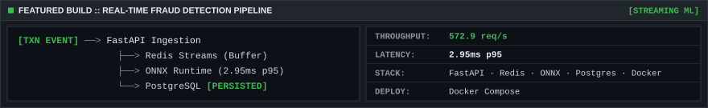

<!-- Top Utility Strip (single-line inline links so GitHub never splits <code> blocks) -->

  <a href="mailto:tuandatpnguyen.work@gmail.com"><code>[email]</code></a> &middot;
  <a href="https://www.linkedin.com/in/pham-nguyen-tuan-dat-3803632a4/"><code>[linkedin]</code></a> &middot;
  <a href="https://github.com/DatPNguynXzyU?tab=repositories"><code>[repositories]</code></a> &middot;
  <a href="https://github.com/DatPNguynXzyU"><code>[portfolio]</code></a>

<!-- Portal Banner -->

  

 

### `OPERATOR.TXT`

> **B.S. in Computer Science** student at **HUTECH University** (Ho Chi Minh City · **GPA 3.25** · Expected Graduation **2027** · English **CEFR B2 Cambridge**).  
> Focused on pragmatic backend REST APIs, real-time ML &amp; speech pipelines, cross-platform Flutter apps, and systematic debugging over bloated abstractions.

---

### `FEATURED_BUILDS.DIR`

| Module | Domain | Stack | Summary |
| :--- | :--- | :--- | :--- |
| [**Real-Time Fraud Detection Pipeline**](https://github.com/DatPNguynXzyU?tab=repositories) | `Streaming ML` | `FastAPI · Redis Streams · ONNX · PostgreSQL · Docker` | Low-latency transaction anomaly detection pipeline benchmarked with ONNX Runtime. |
| [**Real-Time Speech-to-Text Application**](https://github.com/DatPNguynXzyU?tab=repositories) | `AI & Speech` | `Python · Whisper API · Speech Recognition · REST APIs` | Live microphone audio streaming and low-latency automatic transcript generation. |
| [**Medicine Recommendation Website**](https://github.com/DatPNguynXzyU?tab=repositories) | `Web & C# API` | `C# · REST API · Database · HTML · CSS` | Searchable medicine database recommending substitutes based on active ingredients. |
| [**Digital Pilgrimage (AppTungKinh)**](https://github.com/DatPNguynXzyU?tab=repositories) | `Mobile App` | `Flutter · Dart · Firebase Auth · Redis` | Cross-platform temple discovery and tour booking app with Redis caching. |
| [**AniList Telegram Manga Tracker**](https://github.com/DatPNguynXzyU?tab=repositories) | `Automation` | `Python · GraphQL · Telegram API · PythonAnywhere` | Headless bot syncing live manga chapter updates via AniList GraphQL. |
| [**Applied Cryptography Suite**](https://github.com/DatPNguynXzyU?tab=repositories) | `Security` | `Python · Flask · PyQt5 · RSA / ECC` | Desktop &amp; web implementations of RSA, ECC/ECDSA, and classical ciphers. |

  

---

### `TECH_STACK.CFG`

  <table>
    <tr>
      <th align="left"><code>Languages &amp; Backend</code></th>
      <td align="left">
        
        
        
        
        
        
      </td>
    </tr>
    <tr>
      <th align="left"><code>Databases &amp; AI</code></th>
      <td align="left">
        
        
        
        
        
        
        
      </td>
    </tr>
    <tr>
      <th align="left"><code>Mobile, Web &amp; Tools</code></th>
      <td align="left">
        
        
        
        
        
        
        
      </td>
    </tr>
  </table>

---

### `GITHUB_TELEMETRY.LOG`

  <table>
    <tr>
      <td align="center" valign="top">
        
      </td>
      <td align="center" valign="top">
        
      </td>
    </tr>
  </table>

 

<!-- Retro Footer -->

  
   
  <code>DATPNGUYNXZYU // HCMC, VN // HUTECH CS '27</code>
   
  <a href="mailto:tuandatpnguyen.work@gmail.com"><code>tuandatpnguyen.work@gmail.com</code></a>

