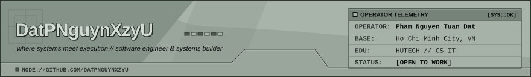

<!-- Top Utility Strip -->

  <code>
    <a href="mailto:pntuandat.work@gmail.com">[email]</a> &middot;
    <a href="https://www.linkedin.com/in/pham-nguyen-tuan-dat-3803632a4/">[linkedin]</a> &middot;
    <a href="https://github.com/DatPNguynXzyU?tab=repositories">[repositories]</a> &middot;
    <!-- TODO: add deployed Vercel URL -->
    <a href="#">[portfolio]</a>
  </code>

 

<!-- Portal Banner -->

  

 

### `OPERATOR.TXT`

> CS/IT student at **HUTECH (Ho Chi Minh City)** focused on pragmatic backend data pipelines, cross-platform Flutter apps, automation bots, and security tooling.  
> Prefers hands-on systems engineering and systematic debugging over bloated abstractions.

---

### `FEATURED_BUILDS.DIR`

<!-- TODO: replace project repository links below with exact GitHub repo URLs -->

| Module | Domain | Stack | Summary |
| :--- | :--- | :--- | :--- |
| [**Real-Time Fraud Detection Pipeline**](https://github.com/DatPNguynXzyU?tab=repositories) | `Streaming ML` | `FastAPI · Redis Streams · ONNX · PostgreSQL · Docker` | Low-latency anomaly detection pipeline benchmarked with ONNX Runtime. |
| [**Digital Pilgrimage (AppTungKinh)**](https://github.com/DatPNguynXzyU?tab=repositories) | `Mobile App` | `Flutter · Dart · Firebase Auth · Redis` | Cross-platform temple discovery and tour booking app with Redis caching. |
| [**AniList Telegram Manga Tracker**](https://github.com/DatPNguynXzyU?tab=repositories) | `Automation` | `Python · GraphQL · Telegram API · PythonAnywhere` | Headless bot syncing live manga chapter updates via AniList GraphQL. |
| [**Applied Cryptography Suite**](https://github.com/DatPNguynXzyU?tab=repositories) | `Security` | `Python · Flask · PyQt5 · RSA / ECC` | Desktop &amp; web implementations of RSA, ECC/ECDSA, and classical ciphers. |

  

---

### `TECH_STACK.CFG`

  <table>
    <tr>
      <th align="left"><code>Backend &amp; Data</code></th>
      <td align="left">
        
        
        
        
        
        
      </td>
    </tr>
    <tr>
      <th align="left"><code>Mobile &amp; Frontend</code></th>
      <td align="left">
        
        
        
        
        
        
      </td>
    </tr>
    <tr>
      <th align="left"><code>DevOps &amp; Tooling</code></th>
      <td align="left">
        
        
        
        
        
      </td>
    </tr>
  </table>

---

### `GITHUB_TELEMETRY.LOG`

  <table>
    <tr>
      <td align="center" valign="top">
        
      </td>
      <td align="center" valign="top">
        
      </td>
    </tr>
  </table>

 

<!-- Retro Footer -->

  
   
  <code>DATPNGUYNXZYU // HCMC, VN // ZERO ROUNDED CORNERS</code>
   
  <a href="mailto:pntuandat.work@gmail.com"><code>pntuandat.work@gmail.com</code></a>

